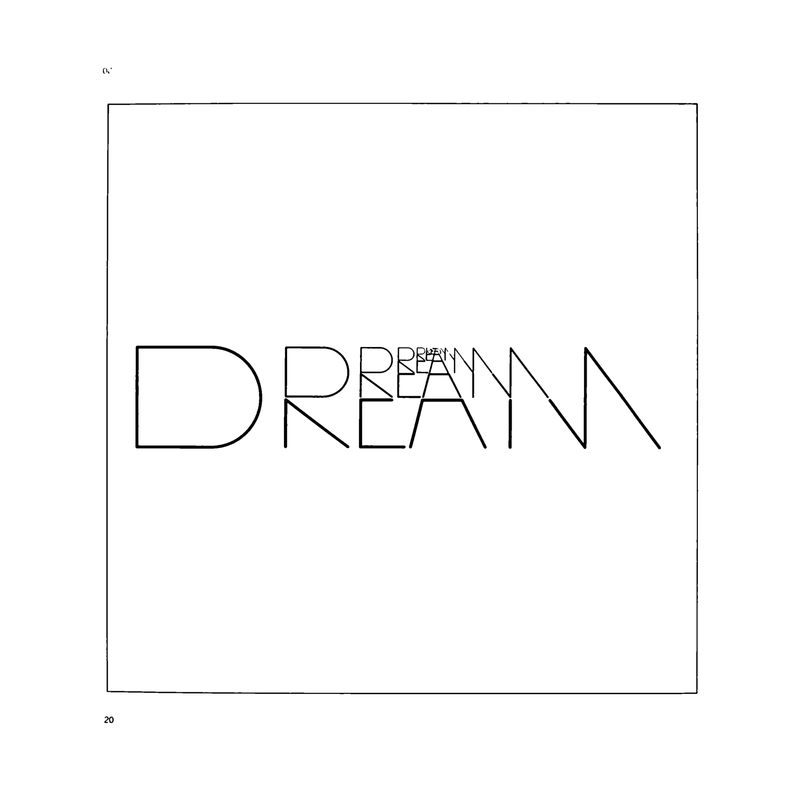
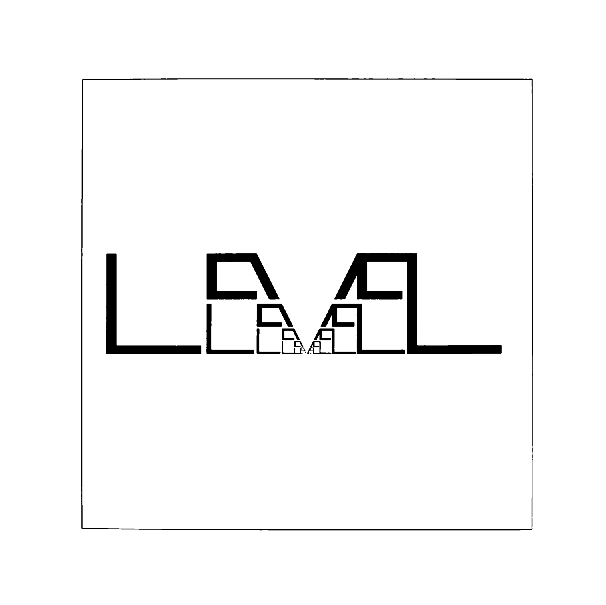
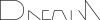

A few years back, I stumbled upon Scott Kim's little known book *Inversions* - a fascinating collection of ambigrams and typographic experiments.
Despite being published in the early '80s, it's full of marvels: horizontally symmetrical words, words that read the same turned upside down, and words formed into grids where letters read differently at the intersections, among other delights.

While most of the typographic tricks weren't entirely new to me, a couple of them really stood out: *Level* and *Dream*. In these, lines are drawn recursively, each part supplementing the whole to form the word itself. The pictures really do speak for themselves:




When I first came across the images, I got excited about the idea of animating them. SVG seemed like the perfect fit. Since SVG was fairly new for me, it took plenty of trial and error - and a bit of tinkering - to achieve what I had in mind, but I'm quite happy with the final result.

<style>
.frame { border: 1px solid black; margin: 2rem 0; }
.frame svg { width: 100%; height: auto; }
</style>

<div class="frame">

</div>

<div class="frame">

</div>

The works remind me of Christopher Nolan's *Inception*. I don't think that's a coincidence, given that both Nolan and Kim seem to draw inspiration from Borges's works. Anyone familiar with his *Circular Ruins* - a story that explores *dreams* and recursive *levels* of reality - will likely see the connection.

## How

Here's the brief summary of how I achieved the result. I'll use the first work as an example; the process for the second is fairly similar.

I started off by retracing the topmost *section* of the drawing in *Inkscape*. Using the raster image as a reference on a separate layer, I drew lines on top to get the close match with the original one:



The nice thing about Inkscape is that it stores project files in SVG format. The not-so-nice part is that the output is bloated and contains lots of metadata. So, instead of parsing it right away, I first ran it through *svgo* to optimise it:

    $ svgo dream_sketch.svg --pretty -o dream_clean.svg

The cleaned-up version turned out much leaner, consisting of just a couple `<path>`s grouped by a `<g>` element. I then cloned the grouping node and resized/moved the copy to determine its scale and coordinates within the viewport. With these values, I calculated the fixed points using the formula:

```python
# f = fixed point (x or y)
# o = offset of the copy within the viewport (x or y)
# s = scale
f = o + (o * s^1) + (o * s^2) + (o * s^3) ...

# Since s < 1, the geometric progression can be simplified to:
f = o * (1 / (1 - s))
```

Pre-calculating the fixed point solved two issues:
1. It made generating scaled down copies easier without recalculating offsets for each iteration.
2. It ensured that elements aligned correctly during animation, landing precisely on the next element’s position after scaling up, which I'll cover below.

Next, I wrote a script to output the partial shape multiple times, each scaled down geometrically:

```python
# x/y = fixed point, s = scale
for i in range(10):
    print(f'<g transform="scale({s ** (i+1)})" transform-origin="{x} {y}">')
    # ... output the paths
    print('</g>')
```

This generated static version of the image. To bring it to life, I added an infinite scaling animation that smoothly expands the shape from its original size to double the size:

```svg
<animateTransform
  attributeName="transform"
  type="scale"
  values="1; 2"
  dur="5s"
  keyTimes="0; 1"
  calcMode="spline"
  keySplines="0.5 0 1 1"
  repeatCount="indefinite"
/>
```

As a finishing touch, I added a fade-out animation to the topmost element to maintain continuity. Otherwise the element would "vanish" abruptly when the animation resets and loops back to the beginning:

```
<animate
  attributeName="opacity"
  to="0"
  dur="5s"
  calcMode="spline"
  keySplines="0.5 0 1 1"
  repeatCount="indefinite"
/>
```

If you’d like to explore further, you can download the source files along with the script [here](dream_level.zip).
