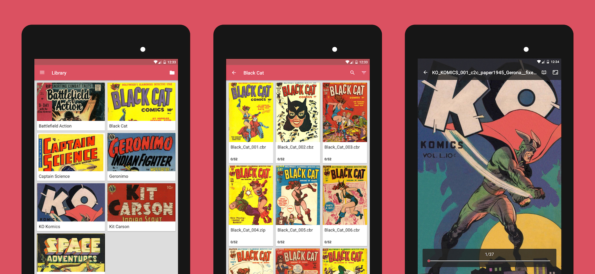

*bubble* is an Android comic book reader.

The project was created in the mid-2010s after purchasing
a [Nexus 7](https://en.wikipedia.org/wiki/Nexus_7_(2013)) mini tablet.
I found existing comic readers at the time either unergonomic,
outdated (not updated to Material Design) or ad-ridden.

The app worked by pointing it to a local directory with comics,
either in archive formats (ZIP/CBZ, RAR/CBR, etc.) or folders
containing comic pages (JPG, PNG etc).

The goal of the project was to:

* provide a simple and intuitive UI with three views:
  * *Library* for comics grouped by folders
  * *List* displaying comics within a group with search and filters
  * *Reader* for viewing an individual comic
* have minimal settings, with all options provided in respective views
  a couple of taps away and without the need for a separate settings page.
* enable a pleasant reading experience for a variety of comics, be it
  western comics, manga or webtoons.
* be resource-efficient, with little RAM usage.

Development of the project halted after I sold my tablet.
There's an active fork that's been picked up by Edgar Soldin
available [here](https://github.com/edeso/bubble2/).

Source code: https://github.com/nkanaev/bubble
